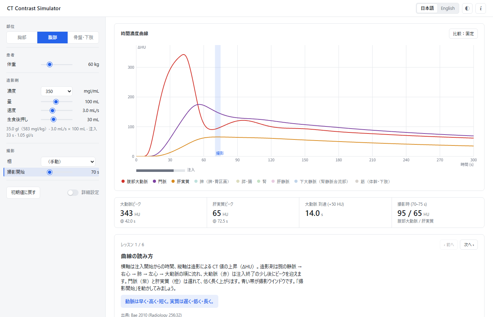

# CT Contrast Simulator

造影 CT の時間濃度曲線（time–enhancement curve）を、Bae らの全身コンパートメント薬物動態モデル（Radiology 1998;207:647、US Patent 5,583,902）で計算する教育用 Web アプリです。体格・造影剤・注入条件・撮影タイミングを動かすと、大動脈・門脈・肝などの曲線と CT 画像がその場で変わります。造影剤の動態と撮影タイミングの考え方を順に学べるよう、ガイド付きのレッスンを用意しています。表示は日本語と英語を切り替えられます。

https://ichikawalab.github.io/ct-contrast-simulator/

> [!WARNING]
> 教育・研究用の近似モデルです。臨床での造影プロトコルの決定や診断には使用できません。医療機器ではありません。

## 使い方

上の URL をブラウザで開くだけで使えます。インストールは不要で、入力した値はどこにも送信されません。

- 左側で条件を設定します：部位（胸部・腹部・骨盤）、体重、造影剤の濃度・量・注入速度・生理食塩水の後押し、撮影の相と開始時刻。
- 右側に時間濃度曲線、主要な数値（大動脈ピーク、肝ピーク、到達時間、撮影時の値）、レッスンが表示されます。レッスンは「次へ」で順に進みます。
- 「比較：固定」を押すと現在の曲線を破線で残せるので、条件を変えたときの違いを重ねて見られます。
- 画面下の CT 画像は、公開データセットの単純 CT に、モデルが計算した各臓器の CT 値上昇（ΔHU）を加えたものです。時刻を動かすと、大動脈・門脈・肝の順に濃くなる様子を確認できます。
- 「詳細設定」をオンにすると、性別・身長・年齢・心拍出量、体重あたりの投与量、2 相注入、HU 係数、PS/Q、数値表、簡易最適化、応用レッスンが使えます。
- モデルのしくみと出典は、画面右上の i から参照できます。

式・パラメータ・出典・検証結果の詳細は [docs/MODEL.md](docs/MODEL.md) にまとめています。

## ライセンス

- ソフトウェアは [MIT License](LICENSE) です。
- `data/` の CT 画像は、TotalSegmentator dataset（CC BY 4.0）の単純 CT 1 例（s1369）を 2 mm に再標本化し、体の外接直方体で切り出したものです。出典: Wasserthal J, Breit HC, Meyer MT, et al. TotalSegmentator: robust segmentation of 104 anatomic structures in CT images. Radiol Artif Intell 2023;5:e230024. Dataset: doi:10.5281/zenodo.10047263

## English

An educational web app that computes CT time–enhancement curves with the whole-body compartmental model of Bae, Heiken and Brink (Radiology 1998;207:647; US Patent 5,583,902). Open the URL above and switch the language at the top right. Model equations, parameters, sources and validation are documented in docs/MODEL.md (Japanese). For education and research only; not a medical device.
